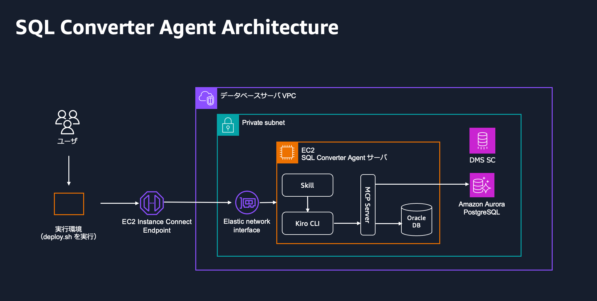

# SQL Converter Agent Workshop

本サンプルスクリプトは、AI エージェントを用いて、 Oracle Database 向けの SQL を Amazon Aurora PostgreSQL 向けに変換するためのスクリプトです。
AWS CDK を使用して Oracle XE on EC2 と Aurora PostgreSQL のデータベースを構築し、ルールベースの SQL 変換ツールである AWS SCT（Schema Conversion Tool）で変換できなかったデータベースオブジェクトと、アプリケーション内の SQL を対象に、[Kiro CLI](https://cli.kiro.dev/) を活用して SQL 変換作業を試みます。

> [!NOTE]
> このコンテンツは Oracle Database と PostgreSQL を立て、この環境に閉じて AI エージェントが SQL を読み書きし、実行し、修正し、結果を残していくものです。
> AI エージェントが Database を操作する都合上、本番環境でのご利用はおやめください。あくまで、ここでコードを生成・テストするだけにとどめてください。

## 🏗️ アーキテクチャ概要

- **Oracle Database**: EC2 インスタンス上の Oracle Database XE 21c
- **PostgreSQL**: Amazon Aurora PostgreSQL Serverless v2（PostgreSQL 17.7）
- **AI エージェント**: Kiro CLI



## 📋 前提条件

### 必要な環境

- シェルスクリプトが動作する環境（Linux, Mac で動作確認）
- Node.js（AWS CDKの実行に使用）
- AWS CLI v2（`aws` コマンド。認証情報の設定済みであること。`ssh-config`が`aws ec2-instance-connect open-tunnel`を使うため、v2が必要です）
- jq（`deploy.sh`がCDK出力のJSONを解析するために使用）
- SSHクライアント（`ssh` / `scp`、変換サーバであるEC2への接続に使用）

### 実行環境

- 上記シェルツールが実行可能なコンピューティングリソース（`deploy.sh`がIAMロール作成・CDKデプロイ・EC2起動・S3操作・SSM実行など広範なAWS操作を行うため、動作確認においては、AdministratorAccessを付与しています。また、AWS CLIの認証情報が設定済みで、実際にAWS環境と通信できる状態である必要があります）

## 🚀 セットアップ手順

### 0. AWS CDKのインストール

```bash
# CDK のインストール
npm install -g aws-cdk
```

### 1. リポジトリのクローン
```bash
git clone https://github.com/aws-samples/sample-sql-converter-agent-workshop.git
cd sample-sql-converter-agent-workshop
```

### 2. CDK 依存関係のインストール

```bash
# CDK依存関係のインストール
# sample-sql-converter-agent-workshop ディレクトリで実行してください
npm ci --prefix cdk
```

`cdk bootstrap`は、手順4の`deploy.sh`の中で実行されます。

### 3. 必要ファイルの準備

**⚠️ 重要: 以下のファイルはユーザーが事前に用意する必要があります**

#### Oracle Database RPM ファイル

`sample-sql-converter-agent-workshop` の配下の `cdk/dmp/` ディレクトリに以下の RPM ファイルをインターネットからダウンロードして配置してください：

- `oracle-database-xe-21c-1.0-1.ol8.x86_64.rpm` - Oracle XE 21c 本体
- `oracle-database-preinstall-21c-1.0-1.el8.x86_64.rpm` - Oracle 前提パッケージ

e.g.

```shell
mkdir -p cdk/dmp && \
wget -P cdk/dmp \
  https://download.oracle.com/otn-pub/otn_software/db-express/oracle-database-xe-21c-1.0-1.ol8.x86_64.rpm \
  https://yum.oracle.com/repo/OracleLinux/OL8/appstream/x86_64/getPackage/oracle-database-preinstall-21c-1.0-1.el8.x86_64.rpm
```


### 4. デプロイ

リポジトリのルートディレクトリに移動した上で、以下コマンドを実行してください。データベースのインストールも含むため、30 分から1時間ほど実行にかかります。

```bash
./deploy.sh
```

このスクリプトは以下の処理を自動実行します：

1. AWS CDKによるインフラストラクチャのデプロイ
    - DMS用のIAMロール（dms-vpc-role）を準備し、cdk bootstrapとcdk deployを実行する
    - 作成されるリソースは次のとおり
      - VPCとEC2 Instance Connect Endpoint
      - Oracle Database XE用のEC2
      - Aurora PostgreSQL Serverless v2
      - DMS Schema Conversionの移行プロジェクト
      - 各DBの認証情報（Secrets Manager）
  
2. EC2キーペアの取得とSSH設定
  
3. Oracle Database XEをEC2にインストール
  
4. エージェントを実行する環境をEC2に準備
    - EC2に、Kiro CLI、uv、gitをインストールする
    - 本ワークショップのリポジトリをgit clone
    

### 5. 接続確認

デプロイ完了後、以下で変換サーバであるEC2に接続してください。初回接続時は接続先の fingerprint が信頼できるかの確認が表示されます（yes/no/[fingerprint]）。`yes` と入力してください。

```bash
ssh -F ssh-config oracle
```

> [!IMPORTANT]
> 以降の手順（接続確認、Kiro CLIへのログイン、エージェントの登録、変換）は、すべて接続先EC2上にある `sample-sql-converter-agent-workshop` ディレクトリで実行します。

接続先で以下のコマンドを実行しデータベースに接続できることを確認してください。

```bash
cd sample-sql-converter-agent-workshop

# Oracle Database接続テスト
uv run ora_connect_test.py

# PostgreSQL接続テスト
uv run pg_connect_test.py
```


### 6. Kiro CLI へのログイン

Kiro CLIは`deploy.sh`で変換サーバであるEC2にインストール済みです。以下でログインしてください。Kiro CLIの詳細は [AWS ブログ:Kiro CLI のご紹介](https://aws.amazon.com/jp/blogs/news/introducing-kiro-cli/) を参照してください。

```bash
kiro-cli login --use-device-flow
# 実行後、表示される指示に従う
```

### 7. エージェントの登録

`agent/kiro/` にある4つのエージェント定義（`scaw-migration-db.json`、`scaw-migration-app.json`、`scaw-migration-db-batch.json`、`scaw-migration-app-batch.json`）をKiro CLIに登録するために、インストールスクリプトを実行してください：

```bash
./agent/scripts/install-agents.sh
```

デフォルトでは、このリポジトリの `.kiro/agents/`（ワークスペースローカル）にインストールされます。どのディレクトリからでも呼び出したい場合は `--global`（`~/.kiro/agents/`にインストール）を、既にインストール済みで上書きしたい場合は `--force` を付けてください。アンインストールする場合は `--uninstall` を使用してください。オプション一覧は `./agent/scripts/install-agents.sh --help` を参照してください。

```bash
kiro-cli agent list | grep scaw-migration   # 登録確認
```


## 🤖 SCAW2.0: Kiro CLI エージェントを使用した変換

> [!NOTE]
> SCAW2.0では、変換ロジックを Strands Agents SDK ベースの単一/マルチエージェント実装から、**Kiro CLI のエージェント構成** に刷新しました。1件ずつ対話しながら変換するときはworker（`scaw-migration-db` / `scaw-migration-app`）を、大量のオブジェクトを並列に変換するときはworkerをサブエージェントとして利用するbatch（`scaw-migration-db-batch` / `scaw-migration-app-batch`）を使います。旧方式（`uv run main.py`、`--multi-agent`等）のコードは、gitの履歴で参照できます（「参考: SCAW1.0（旧方式）」参照）。

> [!NOTE]
> 変換の推論はKiro CLIチャット自体が使うモデルに委ねられ、エージェント定義側でモデルを固定していません。デフォルトは `auto`（Kiro CLI側の自動選択）で、チャット中に `/model` コマンドで変更できます。

> [!NOTE]
> チャット中、`fs_read`等のツール実行で確認（承認プロンプト）を求められることがあります（特にワークスペース外のパス、例: `/tmp/...`にアクセスする場合）。毎回確認されたくない場合は、プロンプト表示時に「Create allow rule to approve future similar actions」を選ぶか、起動時に`kiro-cli chat --agent <name> --trust-tools=fs_read,fs_write,grep,glob`のようにツールを信頼しておくことで、以降確認なしで実行されます。

### 変換の考え方

SCAW2.0が主眼とするのは、**AWS SCT（Schema Conversion Tool）や AWS DMS Schema Conversion が変換できなかった、あるいは未解決のオブジェクトを対象に、どう変換していくか**を体験することです。

ワークショップは大きく2段構成です:

1. **前半（対話的変換：Worker）**: Kiro CLIチャットで1オブジェクト・1ファイルずつ、エージェントと相談しながら変換を進めます。変換のたびに、発見した変換パターンが `agent/skills/workshop-custom-rules/SKILL.md` に追記案として提示されます。レビュー・編集して蓄積してください。
2. **後半（一括変換：Batch）**: 前半で育てたルールを使い、残りのオブジェクト・ファイルを、batchエージェントが複数のworkerに分けて並列に変換します。


### 前半（対話的変換：Worker）

#### DBオブジェクトの変換 (`scaw-migration-db`) 

**入力**: 以下いずれかの出力を事前に用意してください。エージェントがファイルの内容を見て形式を自動判別するため、どちらの形式かを事前に伝える必要はありません。

| 入力ソース | 内容 |
|---|---|
| AWS SCT（単体ツール） | `detail.csv`, `summary.csv`, `converted.sql`（固定名） |
| AWS DMS Schema Conversion | Assessレポート・Convert結果のZIP（S3出力）。ファイル名は動的（`{RDSエンドポイント名}.csv`等） |
| 元のOracle DDL（任意） | 変換前のOracleの定義をまとめたファイル（例: DMS SCが出力する`DDL_oracle.sql`）。同じディレクトリに置くと、元のコードの出力（`oracle.sql`）やOracle側の実行テストに使われます。ない場合は、エージェントがOracleから直接取得します |

ワークショップでは、サンプルオブジェクトを用意しており、`input-sample/db-object/`に同梱しています。

```bash
kiro-cli chat --agent scaw-migration-db
> ./input-sample/db-object/assessment/ にDMS Schema Conversionの出力があります。変換できなかったオブジェクト SCHEMA_SAMPLE.SCT_0001_COMBINED_TYPES_EXAMPLE を変換してください。
```

ご自身のデータで試す場合は、`input/db-object/assessment/`に置いてください。

**DMS Schema ConversionのS3出力を直接指定する場合**: ファイルを手元に置かず、S3パス（`s3://...`）をチャットで伝えることもできます。DMS SCは、変換結果をS3バケット`dms-schema-conversion-<アカウントID>-<リージョン>`の`schema-conversion-results/oracle-to-postgresql-migration-cdk/`に出力します（バケット名は、デプロイ時の`output.json`の`DMSSchemaConversionBucketName`でも確認できます）。S3パスを伝えると、エージェントがファイルを`input/db-object/assessment/`にダウンロードし、ZIPを展開してから変換を始めます。

```bash
kiro-cli chat --agent scaw-migration-db
> DMS Schema Conversionの出力が s3://dms-schema-conversion-<アカウントID>-<リージョン>/schema-conversion-results/oracle-to-postgresql-migration-cdk/*.zip にあります。変換できなかったオブジェクト SCHEMA.PROC_NAME を変換してください。
```

- 必要なファイルは、DMS SCで出力したアセスメント結果のCSV（`ORACLE_POSTGRESQL_<日時>.zip`）、元のOracle DDL（`Oracle-<日時>.zip`）、変換後のPostgreSQL DDL（`PostgreSQL-<日時>.zip`）、およびソースおよびターゲットのSQLファイルの5点です。
- DMS SCを複数回実行していると、日時の異なるZIPが複数並びます。その場合は、使うZIPのファイル名を指定してください。

当該ディレクトリに格納されたSQLファイルに対象オブジェクトの情報が見つからない場合、エージェントはOracleに接続して定義情報を探します。それでもDDLを取得できない場合は、対話で「Oracle側のソースコードを教えてください」と尋ねるので、Oracle DDL/PL-SQLソースを貼り付けてください。

変換結果は `./result/<オブジェクト名>/`（`oracle.sql`, `postgres.sql`, `test_result.txt`, `OK.txt`または`NG.txt`）に出力されます。変換後のSQLはOracle Database・Aurora PostgreSQL双方で実際に実行され、結果が比較されます（`test_result.txt`に記録）。`OK.txt`/`NG.txt`には、変換の主な変更点、テスト結果、注意事項などのサマリーが記載されます。

尚、この変換の過程で見つかったノウハウ・ルールはSKILL（`workshop-custom-rules/SKILL.md`）として蓄積され、残りのオブジェクトの変換に活用されます（後述）。

#### アプリケーションSQLの変換 (`scaw-migration-app`) 

サンプルとしてOracleデータベースを使用した従業員情報の管理を行うSpring + MyBatisアプリケーション（`./input-sample/application/employee-mgmt/`）を変換対象にします。

```bash
kiro-cli chat --agent scaw-migration-app
> ./input-sample/application/employee-mgmt/application のプロジェクトのSQLを変換してください。
```

ご自身のアプリケーションで試す場合は、`input/application/`に置くか、元の場所のパスを指定してください。

変換結果は、元のソースファイルを直接書き換えず「差分」として出力されます（`mode`はエージェントとの対話で指定）。

| mode | 動作 |
|---|---|
| `inplace` | 元のソースファイルを直接書き換える |
| `diff`（デフォルト） | ファイルごとのunified diffを`./result/.../diffs/`に出力する。元のファイルは変更されない |
| `patch` | 複数ファイルの変更を1つの`app-conversion.patch`にまとめて出力する |

静的検証（構文・バインド整合性チェック）に加えて、プレースホルダへの妥当なテスト値をエージェントが判断し、必要に応じて一時テーブルを作成した上でOracle・PostgreSQL双方に実際にSQLを実行して結果を比較する簡易実行テストも行われます（DBオブジェクトの変換時と同様の仕組みです）。

### 後半（一括変換：Batch）、実プロジェクトを想定した大規模並列変換

前半で育てた`workshop-custom-rules/SKILL.md`のルールを使い、残りのオブジェクト・ファイルを`scaw-migration-db-batch` / `scaw-migration-app-batch`で並列に変換します。Kiro CLIのSubagent機能を使い、対象をバッチに分割して複数の`scaw-migration-db` / `scaw-migration-app` インスタンスに並列委譲します。対象が数万オブジェクト規模になる実際の移行プロジェクトでも、同じ仕組みを使えます。

Subagent機能はデフォルトで無効のため、初回のみ有効化が必要です。

```bash
kiro-cli settings chat.enableSubagent true   # 初回のみ
kiro-cli chat --agent scaw-migration-db-batch
> ./input-sample/db-object/assessment/ の残りのオブジェクトを50件ずつのバッチに分けて、scaw-migration-db サブエージェントで並列変換してください。
```

```bash
kiro-cli chat --agent scaw-migration-app-batch
> ./input-sample/application/employee-mgmt/application の残りのファイルを、scaw-migration-app サブエージェントで並列変換してください。
```

既に`./result/`に結果があるオブジェクトは変換済みとして扱われ、残りだけが変換対象になります。

### 変換ルールのカスタマイズ

`agent/skills/workshop-custom-rules/SKILL.md` は、ワークショップ中に育つ変換ルール集です。組み込みの変換ルール（`agent/skills/domain-conversion-rules/SKILL.md`）と合わせて、どちらも自由に編集できます。ワークショップ終了後、実プロジェクトでこの仕組みを使い続ける場合、両ファイルの区分は実質的に薄れ、自由に統合・再編集してよいものになります。

## 参考: SCAW1.0（旧方式）

SCAW1.0の変換ロジック（Strands Agents SDKベース）は、このリポジトリから削除しました。参照する場合は、gitの履歴のコミット`e6c0463`（SCAW2.0に移行する前の最後のコミット）をご覧ください。

```bash
git checkout e6c0463
```

## 既知の制限事項

- `ssh -F ssh-config oracle`（`aws ec2-instance-connect open-tunnel`経由）のWebSocketトンネルは、AWS側の仕様で最大1時間（3600秒）で強制切断されます（`--max-tunnel-duration`はこれより伸ばせません）。1時間を超える長時間の変換作業中に接続が切れた場合は、再接続して中断したKiro CLIセッションを再開してください。

  ```bash
  ssh -F ssh-config oracle
  cd sample-sql-converter-agent-workshop
  kiro-cli chat --agent scaw-migration-db --resume
  ```

  `--resume`で直前の会話が復元され、止まっていた作業の続きから指示できます（会話自体はKiro Agent Server側（クラウド）に保存されているため、SSH切断では失われません）。

## 環境の削除

`./destroy.sh` を実行してください。`./destroy.sh` を実行する際、DMS を使用していた場合は DMS を使用した環境でスキーマ変換ウィザードを Close してから `./destroy.sh` を実行してください。Close しないとエラーが発生して削除ができません。

`./destroy.sh` はAWSリソース（CDKスタック、EC2キーペア）のみを削除します。`install-agents.sh` で登録したKiro CLIエージェント定義も削除したい場合は、別途以下を実行してください（デフォルトのワークスペースローカルインストールの場合、リポジトリ自体を削除すれば自然に消えるため必須ではありませんが、`--global` でインストールした場合は明示的な削除が必要です）。

```bash
./agent/scripts/install-agents.sh --uninstall
```

## 参考: ディレクトリ・ファイル一覧（代表的なものを抜粋）

- `agent/kiro/` 配下のエージェント定義を変更した場合は、`./agent/scripts/install-agents.sh --force` で再登録してください
- エージェント定義・Skillの変更は、Kiro CLIのチャットを起動し直すと反映されます。

### 構成

```
sample-sql-converter-agent-workshop/
├── cdk/                              # AWS環境（CDK）
│   ├── lib/constructs/*.ts           # 作成するAWSリソースの定義
│   ├── scripts/
│   │   └── setup-tools.sh            # デプロイ時にEC2にインストールするツール
│   └── dmp/                          # Oracle XEのRPMファイルの置き場所
├── agent/
│   ├── tools/                        # MCPツール（LLMを使わない決定的な処理）
│   │   ├── convert_oracle_sql_rules.py  # 決定的な変換ルール
│   │   ├── write_db_result.py        # db trackの結果ファイルの書き出し
│   │   ├── server.py                 # MCPツールとして公開する
│   │   └── （その他の*.py）          # 入力の解析、検証、差分出力などの内部処理
│   ├── mcpserver/
│   │   └── oracle.py, postgres.py    # Oracle / Aurora PostgreSQLへの接続とSQLの実行
│   ├── pyproject.toml                # MCPツールが使うPythonパッケージ
│   ├── kiro/                         # エージェント定義
│   │   ├── scaw-migration-db.json    # worker（db track）
│   │   ├── scaw-migration-app.json   # worker（app track）
│   │   ├── scaw-migration-db-batch.json   # batch（db track）
│   │   └── scaw-migration-app-batch.json  # batch（app track）
│   ├── scripts/
│   │   └── install-agents.sh         # エージェント定義をKiro CLIに登録する
│   └── skills/                       # 変換ルール（Skill）
│       ├── workshop-custom-rules/    # ワークショップ中に育てる変換ルール集
│       ├── domain-conversion-rules/  # Oracle → PostgreSQLの標準的な変換ルール
│       ├── domain-proc-to-ecpg/      # Pro*C → ECPGの変換ルール（実験的機能）
│       ├── workflow-db-convert/      # db trackの変換手順
│       ├── workflow-app-convert/     # app trackの変換手順と制約
│       ├── tool-output-layout/       # 出力ファイルの構成
│       ├── tool-db-inventory-schema/ # 変換結果の判定区分（db track）
│       ├── tool-app-inventory-schema/  # 変換結果の判定区分と難易度の分類（app track）
│       └── steering/                 # 全エージェント共通の応答ルール
├── input-sample/                     # 配布するサンプル
│   ├── application/employee-mgmt/    # app trackのサンプルアプリ
│   └── db-object/
│       ├── ddl/                      # デプロイ時にOracleに作成するサンプルオブジェクト
│       └── assessment/               # ddl/をSCT / DMS SCで処理した出力（db trackの入力）
├── input/                            # ご自身のデータの置き場所（中身はgitの管理対象外）
│   ├── application/
│   └── db-object/assessment/
└── result/                           # db trackの変換結果（変換時に自動で作られる。gitの管理対象外）
```

### 更新するタイミング

#### AWS環境（CDK）

| パス | 更新するタイミング |
|---|---|
| `cdk/lib/constructs/*.ts` | インスタンスタイプやAurora PostgreSQLのバージョンなど、環境の構成を変えたいとき |
| `cdk/scripts/setup-tools.sh` | EC2に追加のツールを入れたいとき（現在はKiro CLI、uv、git） |

#### MCPツールとDB接続

| パス | 更新するタイミング |
|---|---|
| `agent/tools/convert_oracle_sql_rules.py` | 機械的に置き換えられる変換ルール（`NVL` → `COALESCE`等）を追加したいとき |
| `agent/tools/write_db_result.py` | 出力ファイルを追加したいとき、`OK.txt`/`NG.txt`の判定基準を変えたいとき |
| `agent/tools/server.py` | 新しいツールを追加したとき |
| `agent/tools/` のその他のファイル | 通常は変更しない。新しい入力形式に対応するときや、不具合を修正するとき |
| `agent/mcpserver/oracle.py`、`postgres.py` | 接続先のデータベースや接続方法を変えたいとき（認証情報はSecrets Managerから取得している） |
| `agent/pyproject.toml` | ツールに新しいPythonパッケージが必要になったとき |

#### エージェント定義

| パス | 更新するタイミング |
|---|---|
| `agent/kiro/scaw-migration-db.json`、`scaw-migration-app.json` | 応答言語や変換方針などのプロンプトを変えたいとき、読み込むSkillやツールを増減するとき |
| `agent/kiro/scaw-migration-db-batch.json`、`scaw-migration-app-batch.json` | バッチサイズの既定値（50件）や、委譲・集計の進め方を変えたいとき |
| `agent/scripts/install-agents.sh` | エージェント定義ファイルを追加・削除したとき |

#### 変換ルール（Skill）

| パス | 更新するタイミング |
|---|---|
| `agent/skills/workshop-custom-rules/SKILL.md` | 頻繁に更新する。エージェントの追記案をレビュー・承認するとき、直接書き足したいとき、実プロジェクトの固有ルールを蓄積するとき |
| `agent/skills/domain-conversion-rules/` | プロジェクトの方針が標準と異なるとき（例: `SYSDATE`の変換先、AWS SCT拡張パックを使うかどうか）、PostgreSQLのバージョンを上げたとき、ワークショップ後に`workshop-custom-rules`と統合するとき |
| `agent/skills/domain-proc-to-ecpg/` | Pro*C（`.pc`）のコードを変換するとき |
| `agent/skills/workflow-db-convert/` | db trackの変換の進め方、テストの手順、`OK.txt`/`NG.txt`に書く内容を変えたいとき |
| `agent/skills/workflow-app-convert/` | app trackの変換の進め方や、必ず守る制約（バインド変数の数を変えない等）を変えたいとき |
| `agent/skills/tool-output-layout/` | 出力ファイルの構成やサマリーの形式を変えたいとき（`agent/tools/write_db_result.py`もあわせて変更する） |
| `agent/skills/tool-db-inventory-schema/`、`tool-app-inventory-schema/` | 判定区分（`pass`、`manual_review_range`等）や難易度の分類の基準を変えたいとき |
| `agent/skills/steering/` | エージェントの応答の仕方（結果の伝え方、パスの扱い、出力ファイルの書き出し方）を変えたいとき |

#### 入力と出力

| パス | 更新するタイミング |
|---|---|
| `input-sample/db-object/ddl/` | ワークショップで扱うサンプルオブジェクト（AWS SCTで変換エラーになるもの）を追加・変更したいとき。変更した場合は、`assessment/`の出力も作り直す |
| `input-sample/db-object/assessment/` | `ddl/`を変更して、SCT / DMS SCの出力を作り直したとき |
| `input-sample/application/employee-mgmt/` | 通常は変更しない |
| `input/application/`、`input/db-object/assessment/` | ご自身のアプリケーションやアセスメント結果で試すとき（アプリケーションが大きい場合は、コピーせず元の場所のパスを指定してもよい） |
| `result/<オブジェクト名>/` | 結果を確認するとき。このディレクトリがあるオブジェクトは「変換済み」として扱われるため、変換し直したい場合はそのオブジェクトのディレクトリを削除する |
| `cdk/dmp/` | 初回のセットアップ時（セットアップ手順の3） |
